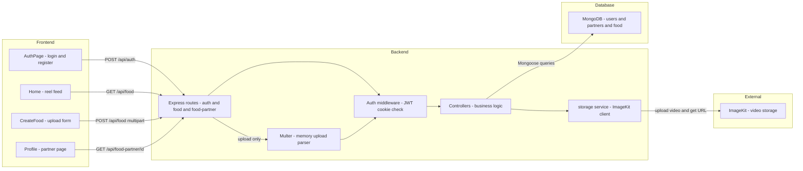
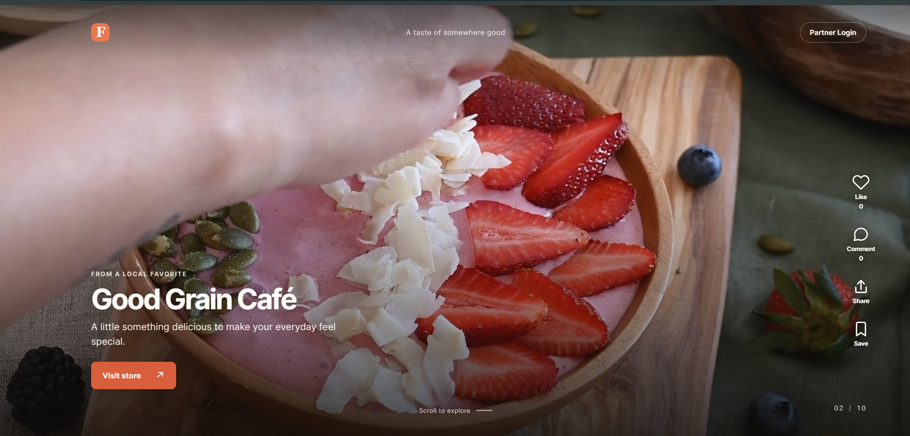
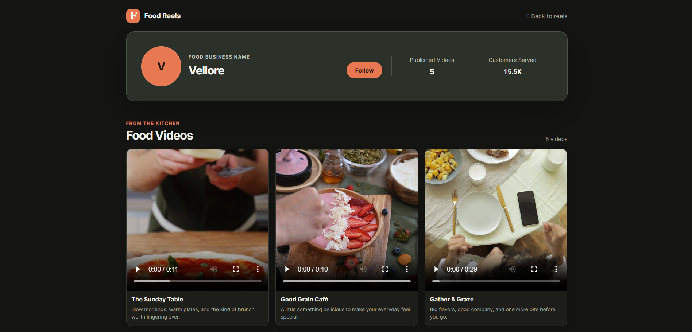
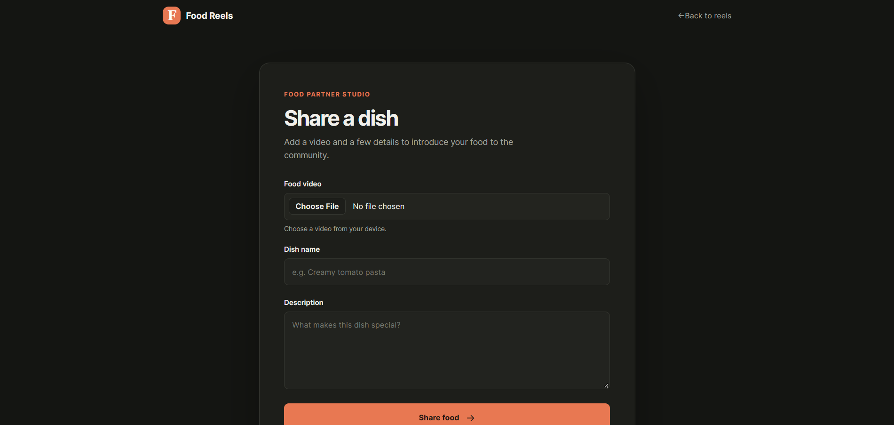

<div align="center">

# 🍔 FoodLoop


[](https://img.shields.io/badge/Node.js-Backend-339933?logo=nodedotjs&logoColor=white)


> ### *🍔 Discover dishes and local food businesses through short, scrollable food videos.*

[🚀 Get Started](#-installation) · [✨ Features](#-features) · [📸 Screenshots](#-screenshots) · [🤝 Contribute](#-contributing)

</div>

---

## 📖 Overview

FoodLoop is a full-stack reel platform that connects hungry people with local food partners through short food videos. The idea is simple: a video shows what a dish looks and feels like far better than a menu, a text review, or a static photo.

The project is built around two kinds of accounts:

- *Users* open a vertical, Instagram-style feed of dishes, interact with reels (like, comment, save, share), and jump straight to the partner's profile page.
- *Food partners* register, upload a video with a dish name and description, and automatically get a public profile page that showcases everything they have published, without managing a separate video host or website.

Under the hood, FoodLoop is a React 19 + TypeScript frontend talking to an Express 5 REST API. It uses MongoDB for data, JWT sessions in HTTP-only cookies for authentication, and ImageKit for video storage.

---

## 🎥 Live Demo


[](https://github.com/user-attachments/assets/14198b4e-92a9-4564-87b4-f220bc5edb78)


---

## ✨ Features

| Feature | Description |
|---|---|
| 🔐 Role-based accounts | Separate register/login flows for users and food partners |
| 🍪 Secure sessions | One-hour JWT stored in an HTTP-only cookie |
| 📱 Vertical reel feed | Scrollable home feed; Intersection Observer (65% threshold) picks the active video |
| ▶️ Smart playback | Active reel autoplays, others pause, and a "Tap to play" button appears if the browser blocks autoplay |
| ❤️ Reel interactions | Like, comment, save, and share (local React state only; not persisted yet) |
| 🔗 Smart sharing | Uses the Web Share API, falls back to the Clipboard API, then reports unsupported states |
| 🎬 Partner publishing | Authenticated partners upload a video plus a dish name and description |
| ☁️ ImageKit storage | Video buffers are sent to ImageKit and the returned URL is saved in MongoDB |
| 🏪 Partner profiles | Business info plus a gallery of all videos the partner has published |
| 🛡️ Protected routes | Middleware verifies the JWT role and account state before protected requests run |

---

## 🏗️ Architecture



---

## 🧰 Tech Stack

| Layer | Technology |
|---|---|
| Frontend | React 19, TypeScript, Vite 8 |
| Routing | React Router DOM 7 |
| HTTP client | Axios 1 |
| Styling | CSS |
| Backend | Node.js, Express 5 (JavaScript, CommonJS) |
| Database | MongoDB with Mongoose 9 |
| Authentication | jsonwebtoken, bcryptjs, cookie-parser |
| File uploads | Multer (memory storage) |
| Media storage | ImageKit |
| Config and CORS | dotenv, cors |

---

## 📸 Screenshots

### Screenshots

**Reel Feed**



**Partner Profile**



**Food Reels Upload Form**



---

## ⚙️ How It Works

1. **Sign up or log in.** `AuthPage` posts to `/api/auth/...` with credentials. The backend hashes passwords with bcryptjs and sets a one-hour JWT in an HTTP-only `token` cookie.
2. **Partners upload.** `CreateFood` sends multipart data to `POST /api/food`. Multer parses the file in memory, auth middleware confirms the `foodPartner` role, and `createFood()` uploads the buffer to ImageKit and saves the returned URL in MongoDB.
3. **Users browse.** `Home` calls `GET /api/food`. Each reel is rendered as a `<video>`, and an Intersection Observer decides which one plays.
4. **Visit a store.** Pressing "Visit store" navigates to `/food-partner/<partnerId>`. `Profile` loads the partner and their food items with two independent requests.

---

## 🚀 Installation

**Prerequisites:** Node.js, npm, a MongoDB connection string, and an ImageKit account.

1. **Clone the repository**

   ```bash
   git clone https://github.com/sandhya144/Food-Reels.git
   cd Food-Reels
   ```

2. **Create `backend/.env`**

   ```text
   MONGODB_URI=your_mongodb_connection_string
   JWT_SECRET=your_long_random_jwt_secret
   IMAGEKIT_PUBLIC_KEY=your_imagekit_public_key
   IMAGEKIT_PRIVATE_KEY=your_imagekit_private_key
   IMAGEKIT_URL_ENDPOINT=your_imagekit_url_endpoint
   PORT=3000
   NODE_ENV=development
   ```

   > `NODE_ENV` should be `development` so cookies work over local HTTP. `PORT` defaults to `3000`.

3. **Install and start the backend**

   ```bash
   cd backend
   npm install
   npm run dev
   ```

   The API starts on `http://localhost:3000` after MongoDB connects.

4. **Install and start the frontend** (in a second terminal)

   ```bash
   cd frontend
   npm install
   npm run dev
   ```

   Vite serves the app at `http://localhost:5173`. Keep both processes running.

---

## 📁 Project Structure

```text
Food-Reels/
├── README.md
├── backend/
│   ├── .env                          - MongoDB, JWT, and ImageKit values
│   ├── server.js                     - Loads env, connects MongoDB, starts Express
│   └── src/
│       ├── app.js                    - Middleware, CORS, route mounts
│       ├── controllers/
│       │   ├── auth.controller.js            - Register, login, me, logout
│       │   ├── food.controller.js            - Create reels, feed, partner food lists
│       │   └── food-partner.controller.js    - Get partner by ID
│       ├── db/db.js                  - Mongoose connection
│       ├── middleware/
│       │   └── auth.middleware.js    - JWT cookie verification
│       ├── models/
│       │   ├── food.model.js
│       │   ├── foodpartner.model.js
│       │   └── user.model.js
│       ├── routes/
│       │   ├── auth.routes.js
│       │   ├── food.routes.js
│       │   └── food-partner.routes.js
│       └── services/
│           └── storage.service.js    - ImageKit upload
└── frontend/
    ├── index.html
    ├── vite.config.ts
    └── src/
        ├── main.tsx                  - React root
        ├── App.tsx                   - Renders AppRoutes
        ├── theme.css, App.css
        ├── components/
        │   └── Brand.tsx             - Brand link
        ├── routes/
        │   └── AppRoutes.tsx         - All browser routes
        ├── assets/videos/            - Bundled sample videos
        └── pages/
            ├── auth/AuthPage.tsx             - User and partner auth forms
            ├── food-partner/
            │   ├── CreateFood.tsx            - Upload a new reel
            │   └── Profile.tsx               - Partner details and gallery
            └── general/Home.tsx              - Reel feed and interactions
```

---

## 📡 API Reference

Base URL: `http://localhost:3000`. Protected routes require the `token` HTTP-only cookie.

### `GET /`
Plain-text health check.

```text
hello World
```

### `POST /api/auth/user/register`
Registers a user and sets the session cookie.

```json
// Request
{
  "fullName": "Alex Morgan",
  "email": "alex@example.com",
  "password": "a-password"
}

// Success
{
  "message": "User Registered Successfully",
  "role": "user",
  "account": { "_id": "mongo-user-id", "email": "alex@example.com", "name": "Alex Morgan", "role": "user" },
  "user": { "_id": "mongo-user-id", "email": "alex@example.com", "fullName": "Alex Morgan" }
}

// Error
{ "message": "User already exists" }
```

### `POST /api/auth/user/login`

```json
// Request
{ "email": "alex@example.com", "password": "a-password" }

// Success
{
  "message": "User logged in successfully",
  "role": "user",
  "account": { "_id": "mongo-user-id", "email": "alex@example.com", "name": "Alex Morgan", "role": "user" },
  "user": { "_id": "mongo-user-id", "email": "alex@example.com", "fullName": "Alex Morgan" }
}

// Error
{ "message": "Invalid email or password" }
```

### `POST /api/auth/food-partner/register`

```json
// Request
{
  "businessname": "Sunday Table",
  "name": "Alex Morgan",
  "email": "partner@example.com",
  "password": "a-password",
  "phone": "+1-555-000-0000"
}

// Success
{
  "message": "Food partner registered successfully",
  "role": "foodPartner",
  "foodPartner": {
    "_id": "mongo-food-partner-id",
    "email": "partner@example.com",
    "name": "Alex Morgan",
    "phone": "+1-555-000-0000",
    "businessname": "Sunday Table"
  }
}

// Error
{ "message": "Food partner account already exists" }
```

### `POST /api/auth/food-partner/login`

```json
// Request
{ "email": "partner@example.com", "password": "a-password" }

// Success
{
  "message": "Food partner logged in successfully",
  "role": "foodPartner",
  "account": { "_id": "mongo-food-partner-id", "email": "partner@example.com", "name": "Sunday Table", "role": "foodPartner" },
  "foodPartner": { "_id": "mongo-food-partner-id", "email": "partner@example.com", "name": "Sunday Table", "role": "foodPartner" }
}

// Error
{ "message": "Invalid email or password" }
```

### `GET /api/auth/me`
Returns the account tied to the current cookie.

```json
// Success
{
  "role": "user",
  "account": { "_id": "mongo-user-id", "email": "alex@example.com", "name": "Alex Morgan", "role": "user" }
}

// Error
{ "message": "Please login first" }
```

### Logout
`GET /api/auth/user/logout`, `GET /api/auth/food-partner/logout`, and `POST /api/auth/logout` all clear the cookie.

```json
{ "message": "Logged out successfully" }
```

### `POST /api/food`
Creates a reel. Food partner only. The request is `multipart/form-data`.

```json
// Request fields
{
  "video": "video file",
  "name": "Creamy tomato pasta",
  "description": "A slow-simmered tomato pasta finished with cream."
}

// Success
{
  "message": "food created successfully",
  "food": {
    "_id": "mongo-food-id",
    "name": "Creamy tomato pasta",
    "video": "https://ik.imagekit.io/example/video-name",
    "description": "A slow-simmered tomato pasta finished with cream.",
    "foodPartner": "mongo-food-partner-id"
  }
}

// Error
{ "message": "Food partner access required" }
```

### `GET /api/food`
Returns all reels. Requires a logged-in user or food partner.

```json
// Success
{
  "message": "Food items fetched successfully",
  "foodItems": [
    {
      "_id": "mongo-food-id",
      "name": "Creamy tomato pasta",
      "video": "https://ik.imagekit.io/example/video-name",
      "description": "A slow-simmered tomato pasta finished with cream.",
      "foodPartner": { "_id": "mongo-food-partner-id", "businessname": "Sunday Table" }
    }
  ]
}

// Error
{ "message": "Please login first" }
```

### `GET /api/food/partner/:id`
Public. Returns every food item uploaded by one partner.

```json
// Success
{
  "message": "Food items fetched successfully",
  "foodItems": [
    {
      "_id": "mongo-food-id",
      "name": "Creamy tomato pasta",
      "video": "https://ik.imagekit.io/example/video-name",
      "description": "A slow-simmered tomato pasta finished with cream.",
      "foodPartner": "mongo-food-partner-id"
    }
  ]
}
```

### `GET /api/food-partner/:id`
Requires a logged-in user or food partner.

```json
// Success
{
  "message": "Food partner retrieved successfully",
  "foodPartner": {
    "_id": "mongo-food-partner-id",
    "businessname": "Sunday Table",
    "name": "Alex Morgan",
    "email": "partner@example.com",
    "phone": "+1-555-000-0000"
  }
}

// Error
{ "message": "Food partner not found" }
```

---

## 🛠️ Troubleshooting

<details>
<summary><b>1. PowerShell does not recognize npm</b></summary>

**Error**

```text
npm : The term 'npm' is not recognized as the name of a cmdlet, function, script file, or operable program.
```

**Why:** Node.js or npm is not installed, or it is not on your `PATH`.

**Fix:** Install Node.js, reopen your terminal, and verify:

```bash
node --version
npm --version
```

</details>

<details>
<summary><b>2. MongoDB connection fails during backend startup</b></summary>

**Error**

```text
MongoDB connection failed: <Mongoose connection error>
```

**Why:** `MONGODB_URI` in `backend/.env` is missing or wrong, MongoDB Atlas is blocking your network, or the credentials are invalid.

**Fix:** Set a valid `MONGODB_URI`, allow your IP in MongoDB Atlas network access, then restart:

```bash
cd backend
npm run dev
```

</details>

<details>
<summary><b>3. Browser blocks requests with a CORS error</b></summary>

**Error**

```text
Access to XMLHttpRequest at 'http://localhost:3000/...' from origin 'http://localhost:5173' has been blocked by CORS policy: The 'Access-Control-Allow-Credentials' header in the response is missing or it is 'false'.
```

**Why:** The frontend and backend origins do not match, or the backend is not running with the CORS credentials config in `backend/src/app.js`.

**Fix:** Run the frontend on `http://localhost:5173`, keep `origin: "http://localhost:5173"` and `credentials: true` in `backend/src/app.js`, then restart both servers.

</details>

---

## 🗺️ Roadmap

- [ ] Server-side validation for auth fields, passwords, phone numbers, and upload bodies
- [ ] Tests for auth, middleware, food controllers, storage uploads, and frontend routes
- [ ] Persist likes, saved reels, and comments in MongoDB with API endpoints
- [ ] A real follow system (replace local `isFollowing` state)
- [ ] Replace the hard-coded customer count with real profile statistics
- [ ] Forgot-password, Terms, Privacy Policy, and help routes
- [ ] Loading and API error states in `Profile.tsx`
- [ ] Consistent error responses for missing uploads and ImageKit failures
- [ ] Add `backend/.env.example`
- [ ] Add a license file
- [ ] Move hard-coded `http://localhost:3000` URLs into environment config
- [ ] Remove unused bundled sample videos
- [ ] Production CORS configuration and secure deployment settings

---

## 🤝 Contributing

```bash
# 1. Fork https://github.com/sandhya144/Food-Reels, then clone your fork
git clone https://github.com/<your-username>/Food-Reels.git
cd Food-Reels

# 2. Create a feature branch
git switch -c feature/your-change

# 3. Install dependencies (add backend/.env first, see Installation)
cd backend && npm install
cd ../frontend && npm install

# 4. Check lint and build before committing
npm run lint
npm run build

# 5. Review, commit, and push
git status
git diff
git add README.md backend frontend
git commit -m "Describe the implemented change"
git push origin feature/your-change
```

Then open a pull request on the original repository describing the problem, your implementation, and how you verified it.

---

## 🔒 Privacy and Safety Notes

- Passwords are hashed with bcryptjs (10 salt rounds) and never stored in plain text.
- Sessions use an HTTP-only cookie, so JavaScript in the browser cannot read the token.
- Never commit `backend/.env`. It holds your JWT secret, MongoDB URI, and ImageKit keys.
- Uploaded videos are stored on ImageKit and are visible to any logged-in user through the feed, and publicly through `GET /api/food/partner/:id`.
- Server-side validation is still on the roadmap, so treat this project as a learning or prototype build until that is added.

---

## 📬 Contact

- **Repository:** [github.com/sandhya144/FoodLoop](https://github.com/sandhya144/FoodLoop)
- **Owner:** [@sandhya144](https://github.com/sandhya144)
- **License:** No license is currently declared, so the project should not be treated as open source until the owner adds one.

## 🙏 Acknowledgements

Built with [React](https://react.dev), [Vite](https://vite.dev), [Express](https://expressjs.com), [MongoDB](https://www.mongodb.com), [Mongoose](https://mongoosejs.com), and [ImageKit](https://imagekit.io).

---

<div align="center">

[⬆️ Back to top](#-foodloop)

</div>